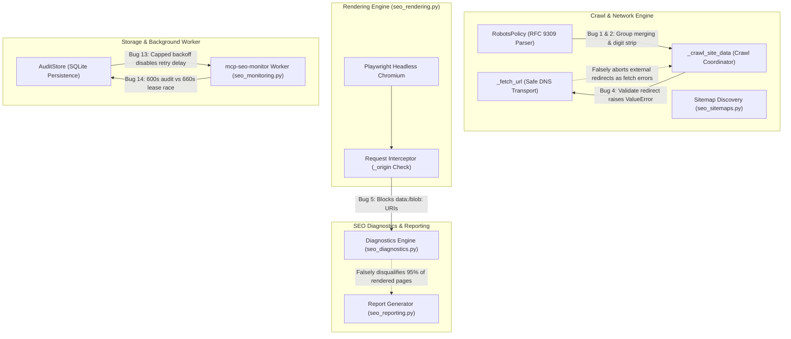

# MCP SEO Audit (`mcp-seo-audit`): Comprehensive Technical Audit & Issue Inventory

This document provides a thorough audit of the [`mcp-seo-audit`](file:///Users/nita/.gemini/antigravity/scratch/mcp-seo-audit) codebase. Each issue is categorized by subsystem and severity, complete with root-cause analysis, reproduction triggers, affected files/lines, and concrete fix recommendations.

---

## Architecture & Failure Hotspots



---

## 1. Critical & High-Severity Logic Bugs (Crawl & Parser Failures)

### Issue 1: User-Agent Group Merging & Directive Leak on `Crawl-delay` or Empty `Disallow`
- **Location:** [`seo_robots.py:89-120`](file:///Users/nita/.gemini/antigravity/scratch/mcp-seo-audit/seo_robots.py#L89-L120) in [`RobotsPolicy.__init__`](file:///Users/nita/.gemini/antigravity/scratch/mcp-seo-audit/seo_robots.py#L89)
- **Severity:** Critical
- **Root Cause:**
  In RFC 9309, a record group starts with one or more `User-agent:` lines and is followed by directives (`Allow:`, `Disallow:`, or non-standard `Crawl-delay:`). In [`seo_robots.py`](file:///Users/nita/.gemini/antigravity/scratch/mcp-seo-audit/seo_robots.py), `has_rule` is only set to `True` when `field in {"allow", "disallow"}`. If a group contains *only* a `Crawl-delay` directive (e.g. `User-agent: *\nCrawl-delay: 10`) or an empty `Disallow:` line (which is skipped on line 102), `has_rule` remains `False`. When the subsequent `User-agent: SpecificBot` is parsed, the parser fails to close the group and appends `SpecificBot` to `agents`.
- **Impact:**
  Specific crawler directives get merged with wildcard `*` crawlers. Normal search engines matching `*` falsely inherit `Disallow` rules meant only for bad bots or specific crawlers, leading to false-positive crawl blocks and incorrect audit boundaries.
- **Fix:**
  Set `has_rule = True` whenever any directive (including `Crawl-delay` and empty `Disallow`) is processed for an active agent group, or finalize groups whenever `field == "user-agent"` is encountered after any previous directives:
  ```python
  if field == "user-agent":
      if has_rule or delays:
          groups.append((agents, rules, delays))
          agents, rules, delays = [], [], []
          has_rule = False
  ```

---

### Issue 2: Product Token Regex Strips Digits & Truncates Bot Names
- **Location:** [`seo_robots.py:95`](file:///Users/nita/.gemini/antigravity/scratch/mcp-seo-audit/seo_robots.py#L95)
- **Severity:** High
- **Root Cause:**
  The parser tokenizes user-agent names with:
  ```python
  token = re.match(r"[a-z_-]+", value.lower())
  ```
  RFC 9309 section 2.2.1 specifies that product tokens follow RFC 9110 token rules (`1*tchar`), which includes ASCII digits (`0-9`).
- **Impact:**
  - Any bot starting with a number (e.g. `360Spider`, `2ipbot`) produces `None` and is dropped from `agents`.
  - Any bot with numbers or version specifiers (e.g. `bot-v2`, `crawler1`, `bingbot/2.0`) is truncated at the first digit (e.g. `bot-v`).
- **Fix:**
  Update the regex to include digits:
  ```python
  token = re.match(r"[a-z0-9_-]+", value.lower())
  ```

---

### Issue 3: `X-Robots-Tag` Scope Leak Across Comma-Separated Directives
- **Location:** [`gsc_server.py:686-697`](file:///Users/nita/.gemini/antigravity/scratch/mcp-seo-audit/gsc_server.py#L686-L697) in [`_googlebot_directives`](file:///Users/nita/.gemini/antigravity/scratch/mcp-seo-audit/gsc_server.py#L680)
- **Severity:** High
- **Root Cause:**
  In [`_googlebot_directives`](file:///Users/nita/.gemini/antigravity/scratch/mcp-seo-audit/gsc_server.py#L680), `applies = True` is declared outside the directive loop:
  ```python
  for header in ([x_robots] if isinstance(x_robots, str) else x_robots):
      applies = True
      for part in header.lower().split(","):
          scoped = re.match(r"^\s*([a-z][a-z0-9_-]*)\s*:\s*(.*)$", part)
          if scoped and scoped[1] not in parameterized_rules:
              applies = scoped[1] == "googlebot"
              part = scoped[2]
          if applies:
              directives.update(tokens(part))
  ```
- **Impact:**
  If a header contains a directive scoped to another bot followed by an unscoped directive (e.g. `X-Robots-Tag: bingbot: noindex, noarchive`), `applies` becomes `False` on `bingbot: noindex` and *never resets back to True*. The unscoped `noarchive` directive (intended for all search engines including Googlebot) is silently discarded.
- **Fix:**
  Reset `applies` for each part unless an explicit bot prefix overrides it:
  ```python
  for part in header.lower().split(","):
      part = part.strip()
      scoped = re.match(r"^([a-z][a-z0-9_-]*)\s*:\s*(.*)$", part)
      if scoped and scoped[1] not in parameterized_rules:
          if scoped[1] == "googlebot":
              directives.update(tokens(scoped[2]))
      else:
          directives.update(tokens(part))
  ```

---

### Issue 4: Unreachable `external_redirect` Handling & False-Positive Fetch Errors
- **Location:** [`gsc_server.py:2563-2565`](file:///Users/nita/.gemini/antigravity/scratch/mcp-seo-audit/gsc_server.py#L2563-L2565), [`gsc_server.py:2637-2650`](file:///Users/nita/.gemini/antigravity/scratch/mcp-seo-audit/gsc_server.py#L2637-L2650), [`gsc_server.py:574-575`](file:///Users/nita/.gemini/antigravity/scratch/mcp-seo-audit/gsc_server.py#L574-L575)
- **Severity:** High
- **Root Cause:**
  When crawling, [`_crawl_site_data`](file:///Users/nita/.gemini/antigravity/scratch/mcp-seo-audit/gsc_server.py#L2550) passes `validate_redirect` to [`_fetch_url`](file:///Users/nita/.gemini/antigravity/scratch/mcp-seo-audit/gsc_server.py#L540). `validate_redirect` explicitly raises `ValueError("External redirect blocked before fetch: ...")` when `target` points off-origin.
  Inside [`_fetch_url`](file:///Users/nita/.gemini/antigravity/scratch/mcp-seo-audit/gsc_server.py#L540), when HTTP 301/302 redirects to an external URL, `redirect_validator(next_url)` runs and throws `ValueError`. This exception escapes [`_fetch_url`](file:///Users/nita/.gemini/antigravity/scratch/mcp-seo-audit/gsc_server.py#L540) and is caught by the generic `except Exception as exc:` block at line 2717.
- **Impact:**
  The entire dedicated external redirect handler (lines 2637–2650) is unreachable dead code. Every valid external redirect is miscategorized as a critical `state: "fetch_error"`, `status: "ERROR"`, generating false alerts.
- **Fix:**
  In [`_fetch_url`](file:///Users/nita/.gemini/antigravity/scratch/mcp-seo-audit/gsc_server.py#L540), when `redirect_validator` signals an external redirect or raises a specific `ExternalRedirectException`, return the 3xx redirect response directly to the crawler without following the off-origin hop, allowing [`_crawl_site_data`](file:///Users/nita/.gemini/antigravity/scratch/mcp-seo-audit/gsc_server.py#L2550) to record `state: "external_redirect"`.

---

### Issue 5: Inline `data:`/`blob:` URIs Trigger Blanket Diagnostics Ineligibility
- **Location:** [`seo_rendering.py:188-192`](file:///Users/nita/.gemini/antigravity/scratch/mcp-seo-audit/seo_rendering.py#L188-L192) in [`_origin`](file:///Users/nita/.gemini/antigravity/scratch/mcp-seo-audit/seo_rendering.py#L188), and [`seo_diagnostics.py:123-125`](file:///Users/nita/.gemini/antigravity/scratch/mcp-seo-audit/seo_diagnostics.py#L123-L125) in `eligible(page)`
- **Severity:** High
- **Root Cause:**
  Chromium fires internal network route events when loading inline assets (`data:image/svg+xml;...`, `data:font/...`, `blob:...`). In [`seo_rendering.py`](file:///Users/nita/.gemini/antigravity/scratch/mcp-seo-audit/seo_rendering.py), every intercepted route passes through `validate_target(target)` -> `_origin(target)`. `_origin` strictly checks `if parsed.scheme not in {"http", "https"}: raise ValueError(...)`.
  This aborts the route and logs it to `blocked_requests`. Because `blocked_requests` is non-empty, `render_page` marks `rendering["status"] = "partial"`.
  Then, in [`seo_diagnostics.py`](file:///Users/nita/.gemini/antigravity/scratch/mcp-seo-audit/seo_diagnostics.py):
  ```python
  if rendering and (rendering.get("status") != "complete" or any(rendering.get(key) for key in
          ("error", "blocked_requests", "js_errors", "pending_requests", "resource_redirects"))):
      return False
  ```
- **Impact:**
  Nearly all modern websites use inline SVG data URIs, icons, or fonts. When JavaScript rendering is enabled, every such page is rejected by `eligible(page)`. Structured data audits (Schema.org JSON-LD) and hreflang audits are completely skipped for virtually all rendered pages.
- **Fix:**
  Allow `data:` and `blob:` schemes to proceed directly inside Playwright via `await route.continue_()` or bypass `_origin` validation, and do not treat blocked inline `data:` URIs or benign console errors as rendering failures in `eligible(page)`.

---

## 2. SEO Diagnostics & Reporting Flaws

### Issue 6: Valid String Breadcrumb `position` Flagged as Schema Violation
- **Location:** [`seo_diagnostics.py:326-328`](file:///Users/nita/.gemini/antigravity/scratch/mcp-seo-audit/seo_diagnostics.py#L326-L328)
- **Severity:** Medium
- **Root Cause:**
  ```python
  if type(position) is not int or position < 1:
      fields.append(prefix + ".position")
  ```
  Schema.org and Google Search Central explicitly permit integer representation as numeric strings (e.g. `"position": "1"` or `"position": 1`).
- **Impact:**
  Emits false-positive `structured_breadcrumb_required` errors against valid CMS platforms (WordPress, Shopify, Next.js) that serialize JSON-LD numbers as strings.
- **Fix:**
  Permit string representations that parse to positive integers:
  ```python
  valid_int = isinstance(position, int) and not isinstance(position, bool) and position >= 1
  valid_str = isinstance(position, str) and position.isdigit() and int(position) >= 1
  if not (valid_int or valid_str):
      fields.append(prefix + ".position")
  ```

---

### Issue 7: Product `Offer` Omits `priceCurrency` Validation
- **Location:** [`seo_diagnostics.py:300-305`](file:///Users/nita/.gemini/antigravity/scratch/mcp-seo-audit/seo_diagnostics.py#L300-L305)
- **Severity:** Medium
- **Root Cause:**
  Google documentation states that for `Offer`, both `price` and `priceCurrency` are required. In [`seo_diagnostics.py`](file:///Users/nita/.gemini/antigravity/scratch/mcp-seo-audit/seo_diagnostics.py#L300), `AggregateOffer` verifies `priceCurrency` with a 3-letter ISO code regex, but standard `Offer` checks only `_present(target.get("price"))` and completely skips `priceCurrency`.
- **Impact:**
  Invalid Product Schema missing a currency symbol passes validation without warnings.
- **Fix:**
  Add `priceCurrency` validation for `Offer`:
  ```python
  if target_type == "Offer":
      if not _present(target.get("price")):
          fields.append(prefix + ".price")
      currency = target.get("priceCurrency")
      if not isinstance(currency, str) or not re.match(r"^[A-Z]{3}$", currency.strip().upper()):
          fields.append(prefix + ".priceCurrency")
  ```

---

### Issue 8: Article `datePublished`/`dateModified` Space-Separator Rejection
- **Location:** [`seo_diagnostics.py:351`](file:///Users/nita/.gemini/antigravity/scratch/mcp-seo-audit/seo_diagnostics.py#L351)
- **Severity:** Low
- **Root Cause:**
  The validator enforces `re.match(r"^\d{4}-\d{2}-\d{2}(?:T|$)", value)` before calling `datetime.fromisoformat`. ISO 8601 / RFC 3339 and Schema.org permit space separators (`YYYY-MM-DD HH:MM:SS`), which Python 3.11's `fromisoformat()` supports natively.
- **Impact:**
  Emits false-positive `structured_article_invalid_date` warnings on valid timestamp formats with space separators.
- **Fix:**
  Update regex to `r"^\d{4}-\d{2}-\d{2}(?:[T\s]|$)"`.

---

### Issue 9: Canonical Unavailable Check Bypasses Fetch & Network Errors
- **Location:** [`seo_reporting.py:156-160`](file:///Users/nita/.gemini/antigravity/scratch/mcp-seo-audit/seo_reporting.py#L156-L160)
- **Severity:** Medium
- **Root Cause:**
  ```python
  target = observed.get(target_url)
  if target and (target.get("noindex") or (isinstance(target["status"], int) and target["status"] >= 400)):
      add("canonical_unavailable", "high", ...)
  ```
  When the crawler encounters a connection reset, SSL error, DNS failure, or timeout on a canonical target, it records `target["status"] = "ERROR"`. Because `"ERROR"` is a string, `isinstance(target["status"], int)` evaluates to `False`.
- **Impact:**
  Broken canonical URLs suffering network/DNS failures are ignored instead of flagged as high-severity canonical errors.
- **Fix:**
  Check for non-2xx/3xx integers or string errors:
  ```python
  is_err = target.get("status") == "ERROR" or (isinstance(target.get("status"), int) and target["status"] >= 400)
  if target and (target.get("noindex") or is_err):
  ```

---

### Issue 10: Overloaded Rule ID `"canonical_review"` Masks Regressions
- **Location:** [`seo_reporting.py:41`](file:///Users/nita/.gemini/antigravity/scratch/mcp-seo-audit/seo_reporting.py#L41)
- **Severity:** Medium
- **Root Cause:**
  The rule mapping pairs `("Canonical", "canonical_review", ...)` as a catch-all prefix match. Issues such as `"Canonical URL is not absolute"`, `"Canonical URL contains a fragment"`, `"Canonical URL uses http on an https page"`, and `"Canonical points to another host"` are all assigned `rule_id = "canonical_review"`.
- **Impact:**
  The report comparison diff engine keys findings by `(rule_id, url)`. If a developer fixes a relative canonical by providing an absolute URL, but introduces an accidental HTTP scheme or cross-domain target, the audit diff marks the finding as "persistent" rather than 1 resolved and 1 new regression.
- **Fix:**
  Split into granular rule IDs: `canonical_relative`, `canonical_fragment`, `canonical_http_downgrade`, `canonical_cross_domain`.

---

### Issue 11: Missing HTTP `Link` Header Canonical and Hreflang Inspection
- **Location:** [`gsc_server.py:700-750`](file:///Users/nita/.gemini/antigravity/scratch/mcp-seo-audit/gsc_server.py#L700-L750) in [`_analyze_html_document`](file:///Users/nita/.gemini/antigravity/scratch/mcp-seo-audit/gsc_server.py#L700)
- **Severity:** Medium
- **Root Cause:**
  `_analyze_html_document` extracts `<link rel="canonical">` and `<link rel="alternate" hreflang="...">` exclusively from HTML `<head>` tags via BeautifulSoup.
- **Impact:**
  Google Search fully supports HTTP `Link` headers (RFC 8288 / RFC 5988), which are standard for PDF files, non-HTML documents, and server-side redirects/headers. The server reports "missing canonical" or misses hreflang sets for sites using HTTP header declarations.
- **Fix:**
  Parse response headers for `Link: <url>; rel="canonical"` and `Link: <url>; rel="alternate"; hreflang="..."`.

---

## 3. Storage, Scheduling & Worker Concurrency Flaws

### Issue 12: Missing Project Deletion & Project Modification with 100-Project Limit
- **Location:** [`seo_storage.py:19`](file:///Users/nita/.gemini/antigravity/scratch/mcp-seo-audit/seo_storage.py#L19), [`seo_storage.py:141`](file:///Users/nita/.gemini/antigravity/scratch/mcp-seo-audit/seo_storage.py#L141), [`seo_monitoring.py:77-100`](file:///Users/nita/.gemini/antigravity/scratch/mcp-seo-audit/seo_monitoring.py#L77-L100)
- **Severity:** High
- **Root Cause:**
  `seo_storage.py` and `seo_monitoring.py` implement `create_project`, `list_projects`, and `set_schedule`, but provide no `delete_project` or `update_project` functions. `MAX_PROJECTS = 100` is hardcoded.
- **Impact:**
  Once created, a project cannot be removed or reconfigured (e.g. updating `start_url`, `max_pages`, or `render_mode`) via MCP tools or the CLI. Any typo in a URL or project ID permanently burns one of the 100 available project slots until manual SQLite file editing is performed.
- **Fix:**
  Add `delete_project(project_id)` and `update_project(project_id, ...)` to `AuditStore` with foreign-key cascade cleanup of audit snapshots and events, and expose them as tools in `seo_monitoring.py`.

---

### Issue 13: Inactive Exponential Backoff for Daily & Weekly Audit Schedules
- **Location:** [`seo_storage.py:284`](file:///Users/nita/.gemini/antigravity/scratch/mcp-seo-audit/seo_storage.py#L284) in `finish_failure`
- **Severity:** Medium
- **Root Cause:**
  ```python
  delay = min(project["interval_seconds"] * 2 ** min(failures - 1, 10), max(project["interval_seconds"], 86400))
  ```
  When `interval_seconds` is >= 86400 (e.g. 1 day [default] or 1 week), `max(project["interval_seconds"], 86400)` evaluates directly to `project["interval_seconds"]`.
  Therefore, `min(interval * 2^k, interval)` is mathematically capped at `interval` for all values of `failures >= 1`.
- **Impact:**
  Zero backoff occurs when recurring daily or weekly audits encounter transient errors (e.g. rate limits, 503 maintenance).
- **Fix:**
  Allow backoff to scale up to an absolute cap (e.g. 7 days or 4× interval):
  ```python
  max_delay = max(project["interval_seconds"] * 4, 86400 * 7)
  delay = min(project["interval_seconds"] * (2 ** min(failures - 1, 5)), max_delay)
  ```

---

### Issue 14: Audit Lease Expiration Race Condition Causes Lost Reports & Worker Crash
- **Location:** [`seo_storage.py:23`](file:///Users/nita/.gemini/antigravity/scratch/mcp-seo-audit/seo_storage.py#L23) (`LEASE_SECONDS = 660`), [`seo_monitoring.py:23`](file:///Users/nita/.gemini/antigravity/scratch/mcp-seo-audit/seo_monitoring.py#L23) (`AUDIT_TIMEOUT_SECONDS = 600`), and [`seo_monitoring.py:31-33`](file:///Users/nita/.gemini/antigravity/scratch/mcp-seo-audit/seo_monitoring.py#L31-L33)
- **Severity:** High
- **Root Cause:**
  `LEASE_SECONDS` is 660 seconds (11 min) and `AUDIT_TIMEOUT_SECONDS` is 600 seconds (10 min). With sitemap discovery taking up to 45 seconds prior to crawl, total runtime can reach ~645–660 seconds.
  If an audit finishes near the deadline, `store.finish_success` calls `_leased_project(conn, project_id, token, now)`. If `lease_until < now`, it raises `ValueError("Audit lease expired or was preempted.")`.
  In `seo_monitoring.py:32`, `except (ValueError, TypeError, ...) ` catches this and immediately calls `store.finish_failure(..., "invalid_report")`.
  However, `finish_failure` *also* calls `_leased_project` with the expired lease, which throws `ValueError` again. This unhandled exception crashes the monitoring worker loop, and the 10-minute crawl report is permanently discarded.
- **Impact:**
  Long-running audits result in unhandled exceptions and complete data loss.
- **Fix:**
  Implement periodic lease heartbeat renewal in `AuditStore.renew_lease(project_id, token)`, and ensure `finish_failure` safely handles an already-expired lease without crashing.

---

## 4. Crawling, Sitemap & Parser Inconsistencies

### Issue 15: Duplicate Naive `inspect_robots_txt` Bypasses `RobotsPolicy`
- **Location:** [`gsc_server.py:2336-2361`](file:///Users/nita/.gemini/antigravity/scratch/mcp-seo-audit/gsc_server.py#L2336-L2361)
- **Severity:** Medium
- **Root Cause:**
  Instead of utilizing the compliant `RobotsPolicy` class from `seo_robots.py`, `inspect_robots_txt` re-implements an ad-hoc 25-line text parser.
- **Impact:**
  - Ignores group grouping: if multiple `User-agent:` lines precede directives, `applies_to_wildcard` is overwritten by the last user-agent.
  - Only checks `path == "/"` (ignoring `/*`).
  - Ignores `Allow:` precedence and rule specificity.
  - Gives users incorrect answers about whether their robots.txt blocks crawling.
- **Fix:**
  Refactor `inspect_robots_txt` to instantiate `RobotsPolicy(response.text, user_agent="*")` and query its parsed rules and delays.

---

### Issue 16: Relative Sitemap URL Resolution Mangling in `audit_live_site`
- **Location:** [`gsc_server.py:2923`](file:///Users/nita/.gemini/antigravity/scratch/mcp-seo-audit/gsc_server.py#L2923) & [`gsc_server.py:280-283`](file:///Users/nita/.gemini/antigravity/scratch/mcp-seo-audit/gsc_server.py#L280-L283) in `_ensure_https_url`
- **Severity:** Medium
- **Root Cause:**
  In `audit_live_site`:
  ```python
  if line.lower().startswith("sitemap:"):
      discovered_sitemap = line.split(":", 1)[1].strip()
  ```
  If robots.txt specifies a relative path (e.g. `Sitemap: /sitemap.xml`), `_ensure_https_url` executes:
  ```python
  if not parsed.scheme:
      return f"https://{value.lstrip('/')}"
  ```
- **Impact:**
  Turns `/sitemap.xml` into `https://sitemap.xml` (using the path as the domain name) instead of joining with `origin`. The sitemap fetch subsequently fails with DNS lookup errors.
- **Fix:**
  Resolve relative sitemaps against `origin` using `urljoin(origin, discovered_sitemap)` before passing to `analyze_sitemap`.

---

### Issue 17: Strict Sitemap XML Namespace Rejection
- **Location:** [`seo_sitemaps.py:59`](file:///Users/nita/.gemini/antigravity/scratch/mcp-seo-audit/seo_sitemaps.py#L59) in `_parse_document`
- **Severity:** Medium
- **Root Cause:**
  ```python
  if namespace not in {"", "{http://www.sitemaps.org/schemas/sitemap/0.9}"}:
      raise ValueError("Unsupported sitemap XML namespace.")
  ```
- **Impact:**
  Rejects sitemaps that specify:
  - `http://www.google.com/schemas/sitemap/0.84` (Google's legacy schema, common on older CMS setups).
  - `https://www.sitemaps.org/schemas/sitemap/0.9` (HTTPS variant frequently written by developers).
  Whenever this occurs, `discover_sitemap_urls` fails and discards the entire sitemap inventory.
- **Fix:**
  Accept known namespace variants:
  ```python
  KNOWN_NAMESPACES = {
      "",
      "{http://www.sitemaps.org/schemas/sitemap/0.9}",
      "{https://www.sitemaps.org/schemas/sitemap/0.9}",
      "{http://www.google.com/schemas/sitemap/0.84}",
  }
  if namespace not in KNOWN_NAMESPACES:
      raise ValueError("Unsupported sitemap XML namespace.")
  ```

---

### Issue 18: Fragile String Splitting on Batch Tool Inputs
- **Location:** [`gsc_server.py:1683`](file:///Users/nita/.gemini/antigravity/scratch/mcp-seo-audit/gsc_server.py#L1683) and [`gsc_server.py:1928`](file:///Users/nita/.gemini/antigravity/scratch/mcp-seo-audit/gsc_server.py#L1928)
- **Severity:** Low
- **Root Cause:**
  `urls.split("\n")` strictly expects newline-separated URLs. When an LLM or client provides a JSON array (e.g. `["https://a.com", "https://b.com"]`) or comma-separated URLs, the entire string is either treated as a single invalid URL or fails URL parsing.
- **Impact:**
  Tool invocation failures when driven by diverse LLM callers.
- **Fix:**
  Parse JSON if the string starts with `[` or split on commas and newlines:
  ```python
  if urls.strip().startswith("["):
      try:
          url_list = json.loads(urls)
      except Exception:
          url_list = re.split(r"[\r\n,]+", urls)
  else:
      url_list = re.split(r"[\r\n,]+", urls)
  ```

---

## 5. Operational, Protocol & Environment Risks

### Issue 19: Private FastMCP Attribute Access in `get_server_status`
- **Location:** [`gsc_server.py:3519`](file:///Users/nita/.gemini/antigravity/scratch/mcp-seo-audit/gsc_server.py#L3519)
- **Severity:** Low
- **Root Cause:**
  `get_server_status` queries internal FastMCP structures: `len(mcp._tool_manager._tools)`.
- **Impact:**
  Tight coupling to private SDK internals. Any minor version bump in `mcp` that refactors `_tool_manager` or `_tools` will cause `get_server_status` to throw `AttributeError`.
- **Fix:**
  Safely inspect via `getattr` or public API:
  ```python
  tool_manager = getattr(mcp, "_tool_manager", None)
  tools = getattr(tool_manager, "_tools", {}) if tool_manager else {}
  tool_count = len(tools)
  ```

---

### Issue 20: Misleading `destructiveHint=True` on `run_project_audit`
- **Location:** [`seo_monitoring.py:102`](file:///Users/nita/.gemini/antigravity/scratch/mcp-seo-audit/seo_monitoring.py#L102)
- **Severity:** Low
- **Root Cause:**
  `run_project_audit` is annotated with `ToolAnnotations(readOnlyHint=False, destructiveHint=True, idempotentHint=False, openWorldHint=True)`.
- **Impact:**
  MCP client UIs (Claude Desktop, Cursor, etc.) display prominent warning dialogs asking users to confirm a "destructive action" even though `run_project_audit` only performs a read-only crawl and saves a report to the local database.
- **Fix:**
  Set `destructiveHint=False`.

---

### Issue 21: Python 3.11+ Requirement vs Default macOS Python (3.9.6)
- **Location:** `pyproject.toml:16` (`requires-python = ">=3.11"`)
- **Severity:** Operational
- **Root Cause:**
  The server utilizes `asyncio.timeout` (introduced in Python 3.11) across multiple modules (`gsc_server.py`, `seo_sitemaps.py`, `seo_reporting.py`). Running with `/usr/bin/python3` (which is 3.9.6 on macOS Sonoma/Sequoia) immediately raises `AttributeError: module 'asyncio' has no attribute 'timeout'`.
- **Impact:**
  Users executing `python3 gsc_server.py` directly will fail unless launched via `uv run` or an explicit Python 3.11+ virtual environment.
- **Recommendation:**
  Ensure startup documentation and wrappers clearly specify running through `uv run --python 3.11 mcp-seo-audit`.

---

## Summary Matrix of Issues

| ID | Module / Component | Severity | Category | Description |
|:---|:---|:---|:---|:---|
| **1** | [`seo_robots.py`](file:///Users/nita/.gemini/antigravity/scratch/mcp-seo-audit/seo_robots.py) | **Critical** | Crawler / Logic | Merges wildcard agent into specific agent group on Crawl-delay or empty Disallow |
| **2** | [`seo_robots.py`](file:///Users/nita/.gemini/antigravity/scratch/mcp-seo-audit/seo_robots.py) | **High** | Crawler / Spec | Regex `[a-z_-]+` drops numeric user-agents (e.g. 360Spider) and truncates versions |
| **3** | [`gsc_server.py`](file:///Users/nita/.gemini/antigravity/scratch/mcp-seo-audit/gsc_server.py) | **High** | Crawler / Logic | `X-Robots-Tag` directive parser leaks bot-scope state across directives |
| **4** | [`gsc_server.py`](file:///Users/nita/.gemini/antigravity/scratch/mcp-seo-audit/gsc_server.py) | **High** | Crawler / Flow | Dead code: external redirects raise `ValueError` and misreport as fetch errors |
| **5** | [`seo_rendering.py`](file:///Users/nita/.gemini/antigravity/scratch/mcp-seo-audit/seo_rendering.py) & [`seo_diagnostics.py`](file:///Users/nita/.gemini/antigravity/scratch/mcp-seo-audit/seo_diagnostics.py) | **High** | Renderer / Diagnostics | Blocking inline `data:`/`blob:` URIs marks pages partial, skipping hreflang & schema audits |
| **6** | [`seo_diagnostics.py`](file:///Users/nita/.gemini/antigravity/scratch/mcp-seo-audit/seo_diagnostics.py) | **Medium** | Diagnostics | Schema breadcrumb string position (e.g. `"1"`) falsely flagged as invalid |
| **7** | [`seo_diagnostics.py`](file:///Users/nita/.gemini/antigravity/scratch/mcp-seo-audit/seo_diagnostics.py) | **Medium** | Diagnostics | Single `Offer` omits required `priceCurrency` validation |
| **8** | [`seo_diagnostics.py`](file:///Users/nita/.gemini/antigravity/scratch/mcp-seo-audit/seo_diagnostics.py) | **Low** | Diagnostics | Article date validator rejects valid ISO 8601 dates with space separator |
| **9** | [`seo_reporting.py`](file:///Users/nita/.gemini/antigravity/scratch/mcp-seo-audit/seo_reporting.py) | **Medium** | Reporting | Canonical target unavailable check ignores network/DNS fetch errors (`"ERROR"`) |
| **10** | [`seo_reporting.py`](file:///Users/nita/.gemini/antigravity/scratch/mcp-seo-audit/seo_reporting.py) | **Medium** | Reporting | Overloaded `canonical_review` rule ID masks regressions and fixes in audit diffs |
| **11** | [`gsc_server.py`](file:///Users/nita/.gemini/antigravity/scratch/mcp-seo-audit/gsc_server.py) | **Medium** | Crawler / Spec | HTTP `Link` response headers for Canonical and Hreflang are completely ignored |
| **12** | [`seo_storage.py`](file:///Users/nita/.gemini/antigravity/scratch/mcp-seo-audit/seo_storage.py) | **High** | Storage / UX | No project deletion or update tools; reaching 100 projects permanently locks slots |
| **13** | [`seo_storage.py`](file:///Users/nita/.gemini/antigravity/scratch/mcp-seo-audit/seo_storage.py) | **Medium** | Scheduling | Exponential backoff formula is capped at interval when interval >= 86400 |
| **14** | [`seo_storage.py`](file:///Users/nita/.gemini/antigravity/scratch/mcp-seo-audit/seo_storage.py) & [`seo_monitoring.py`](file:///Users/nita/.gemini/antigravity/scratch/mcp-seo-audit/seo_monitoring.py) | **High** | Worker / Race | 600s audit vs 660s lease race triggers double `ValueError` and worker crash |
| **15** | [`gsc_server.py`](file:///Users/nita/.gemini/antigravity/scratch/mcp-seo-audit/gsc_server.py) | **Medium** | Tool / Parser | `inspect_robots_txt` duplicates robots parsing with naive, inaccurate logic |
| **16** | [`gsc_server.py`](file:///Users/nita/.gemini/antigravity/scratch/mcp-seo-audit/gsc_server.py) | **Medium** | Crawler / Flow | Relative sitemap URLs in `robots.txt` get mangled into invalid domains |
| **17** | [`seo_sitemaps.py`](file:///Users/nita/.gemini/antigravity/scratch/mcp-seo-audit/seo_sitemaps.py) | **Medium** | Sitemap | Strict XML namespace check rejects Google 0.84 and HTTPS sitemap namespaces |
| **18** | [`gsc_server.py`](file:///Users/nita/.gemini/antigravity/scratch/mcp-seo-audit/gsc_server.py) | **Low** | Tool / Robustness | Batch inspection and indexing tools fail when input is JSON or comma-delimited |
| **19** | [`gsc_server.py`](file:///Users/nita/.gemini/antigravity/scratch/mcp-seo-audit/gsc_server.py) | **Low** | SDK / Coupling | Accesses private FastMCP attribute `mcp._tool_manager._tools` |
| **20** | [`seo_monitoring.py`](file:///Users/nita/.gemini/antigravity/scratch/mcp-seo-audit/seo_monitoring.py) | **Low** | MCP Annotation | Unnecessary `destructiveHint=True` on non-destructive crawl tool `run_project_audit` |
| **21** | Global / Environment | **Operational** | Runtime | Requires Python >= 3.11 (`asyncio.timeout`); fails immediately on macOS system Python 3.9 |
